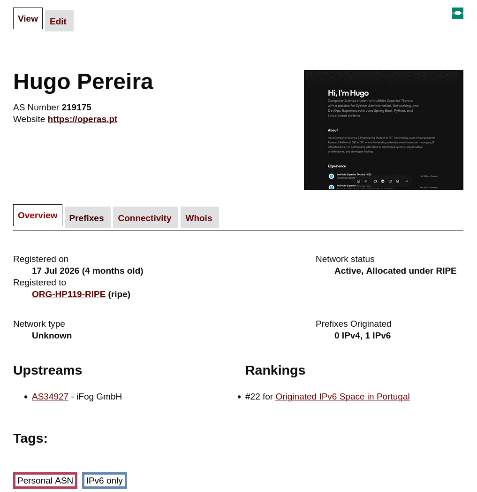
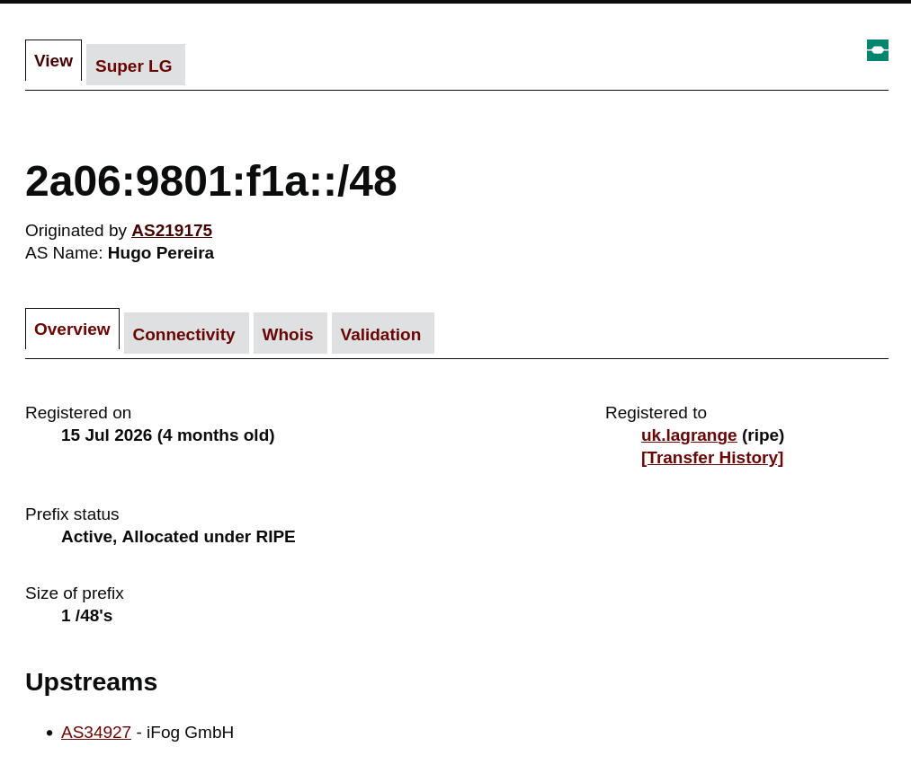
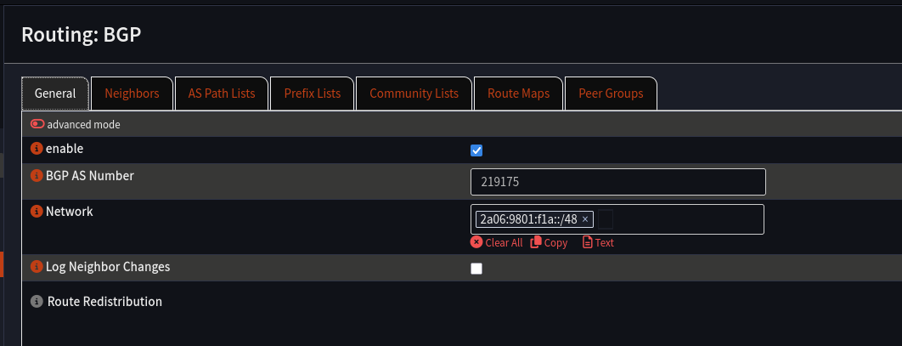
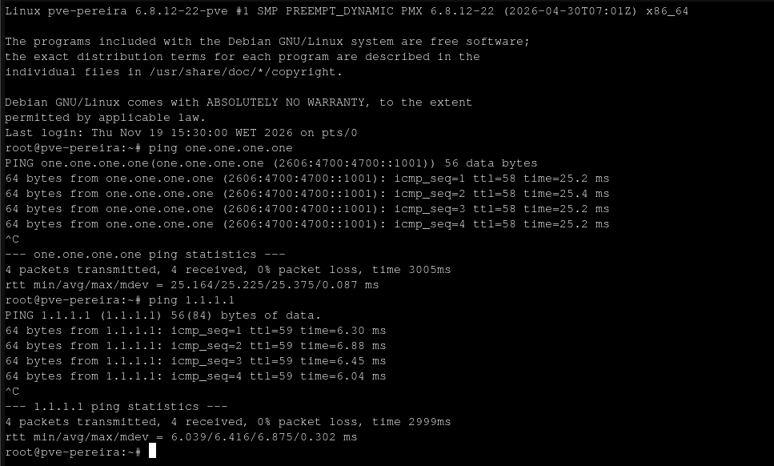

I now have my own ASN, **AS219175**, and an IPv6 block,
**2a06:9801:f1a::/48**. And I'm using addresses from that block at home.

Why? Because... why not?

After [replacing my ISP's router with OPNsense](/posts/router/router),
apparently just controlling the hardware wasn't enough. Now I wanted to run
my own little piece of the internet too.

You can look up [AS219175 on bgp.tools](https://bgp.tools/as/219175#asinfo)
and [the IPv6 prefix here](https://bgp.tools/prefix/2a06:9801:f1a::/48).

## What I Actually Got

An ASN is an identifier for a network on the internet. BGP is how those
networks tell each other which IP addresses they can reach. So I now have
an identity for my network and a block of addresses to announce through it.



A /48 is also a ridiculous amount of IPv6 space for a house: enough for
**65,536 standard /64 subnets**. I am going to run out of things to plug
in long before I run out of addresses.

But having the ASN and the addresses doesn't automatically make them work
at home. Someone still needs to tell the rest of the internet how to get
there.

## The ISP Problem

Residential ISPs generally aren't going to set up BGP with you. Having my
own router didn't change that. My fiber connection was still a normal home
connection, and announcing my own addresses wasn't something I could just
switch on in the customer portal.

So I rented a **VM from iFog**, a host willing to do BGP with me. That VM
became the place where my network, **AS219175**, connects to theirs,
**AS34927**, and where my IPv6 block gets announced to the rest of the
internet.



That solved the internet-facing part. The next problem was that the VM
was in a data centre, and the machines I wanted to use those addresses on
were in my house.

## Getting the Tunnel Home

I connected the VPS to **OPNsense at home using WireGuard**. That gives me
an encrypted link between the two, carried over my existing internet
connection.

On the VPS, the tunnel is wg0, with address fd00:219:175::1. At home,
it's wg1, named WG_BGP in OPNsense, with address fd00:219:175::2.
Those are private addresses used to connect the two routers. The home
peer points to the VPS at 45.134.91.227, on port 51821.

The VPS side of /etc/wireguard/wg0.conf, with the keys removed, looks
like this:

```ini
[Interface]
PrivateKey = <redacted>
Address = fd00:219:175::1/64
ListenPort = 51821

[Peer]
PublicKey = <home-public-key>
AllowedIPs = fd00:219:175::2/128, 2a06:9801:f1a::/48
```

The important part is including my public /48 in the home peer's allowed
addresses, so the tunnel can carry traffic for that block. On OPNsense,
the VPS peer has ::/0 as its allowed addresses, letting it carry IPv6
traffic to and from the wider internet.

The VPS receives traffic for my addresses and sends it through the tunnel
to my router. Traffic going out from home using those addresses goes back
through the VPS. The overall path looks like this:

```text
Internet ↔ iFog ↔ My VPS ↔ WireGuard tunnel ↔ OPNsense ↔ Home devices
```

My ISP just carries the tunnel traffic as part of my normal connection.
It doesn't need to participate in BGP or do anything special with my
IPv6 block.

That's really the whole trick: find somewhere that will announce the
addresses, then give the traffic a way to reach home.

## BIRD on the VPS

The VM runs **BIRD**, which handles the BGP connections. It talks to iFog
on one side and OPNsense on the other, so the VPS knows my block lives at
home and can announce it upstream.

The iFog connection is **eBGP**, between two different networks. The
connection to OPNsense is **iBGP**, since both routers use my ASN, and
runs over the private WireGuard addresses above.

For a small look at the configuration, this is the iFog connection from
/etc/bird/bird.conf, together with its announcement filter:

```text
filter PREFIX_OUT {
    if (net = 2a06:9801:f1a::/48) then {
        bgp_next_hop = 2a0c:9a40:2805:1::197f;
        accept;
    }
    reject;
}

protocol bgp ifog_v6 {
    local 2a0c:9a40:2805:1::197f as 219175;
    neighbor 2a0c:9a40:2805:1::1 as 34927;
    ipv6 {
        import none;
        export filter PREFIX_OUT;
        next hop self;
    };
}
```

The main things happening here are connecting my ASN to iFog's and using a
filter to announce only my own /48. This is one piece of the working
configuration, rather than everything needed to recreate it.

One thing I ended up keeping simple was the routing table. The config has
comments left over from dealing with a flood of internet routes, but with
one upstream I don't need that entire list. The VPS just sends outgoing
IPv6 traffic to iFog through a default route.

The home-facing BGP session accepts my /48 from OPNsense and sends a
default route back, giving the router a way out through the VPS. Linux
IPv6 forwarding is also enabled so the VM can move packets between its
internet interface and the tunnel.

## The OPNsense Clicking Part

At home, I used OPNsense's **Routing → BGP** pages to connect the router to
the VPS and announce my block over the tunnel. Both ends use AS219175,
so they're two parts of the same network.



There were a few pieces to connect in the UI: the VPS as a neighbor, a
prefix list identifying my IPv6 block, and a route map limiting what I
announce to it. In my configuration, those are:

| Piece        | My setting                                                     |
| ------------ | -------------------------------------------------------------- |
| BGP neighbor | iFog_VM, at fd00:219:175::1, using AS219175                    |
| Prefix list  | PF_AS219175, permit 2a06:9801:f1a::/48, sequence 10            |
| Route map    | RM_AS219175_OUT, permit sequence 10, matching that prefix list |

I attached that route map outbound to the VPS neighbor. The point was to
advertise my own addresses and keep the rest of my home network's routes
out of that conversation.

I don't remember every checkbox I touched, and this isn't meant to be a
full walkthrough. Once that connection was working, I could use subnets
from my block on the home networks and let OPNsense handle the routing
and firewall rules as usual.

Both BGP sessions now show **Established**, and the VPS has a route for
my block pointing down the WireGuard tunnel:

```text
2a06:9801:f1a::/48 via fd00:219:175::2 dev wg0 proto bird metric 32
```

That's the VPS being told to send traffic for my block home to OPNsense.
More satisfyingly, I'm actually using those addresses at home.

## And Then There's the Latency

Of course, sending traffic through a VPS adds a detour. To see what that
looks like, I pinged Cloudflare from my home server over this IPv6 setup,
then over the normal IPv4 connection:

| Connection from home   | Destination                            | Average ping | Packet loss |
| ---------------------- | -------------------------------------- | ------------ | ----------- |
| IPv6 through the VPS   | one.one.one.one (2606:4700:4700::1001) | 25.2 ms      | 0%          |
| Normal IPv4 connection | 1.1.1.1                                | 6.4 ms       | 0%          |



That's about **19 ms more** in this small test. Nothing disastrous, but
certainly no speed upgrade. These were four pings each, and IPv4 and IPv6
can take different routes, so this is a quick comparison of the experience
rather than an exact measurement of the tunnel's overhead.

The earlier checks from the VPS put the round trip to home at around
24 ms, so the extra journey is visible. Having a fast connection out of
the data centre doesn't remove the trip between there and my house.

This was an experiment in running my own ASN and getting my own addresses
home. I wasn't trying to build a production setup or improve my ping.
There's another machine to depend on, another tunnel to keep working,
and a longer path for the traffic. For learning how all of this fits
together, though, it's been a fun addition to the homelab.

My house has an ASN now. I'm calling that a successful networking detour.

One last thing: **this isn't a tutorial**. There was a lot of trial and
error on my side, and I haven't captured every setting or every step it
took to get here. Following the snippets in this post may not get you to
the same working result. This is a record of the experiment and what I
ended up with, including some gaps in how I got there.
