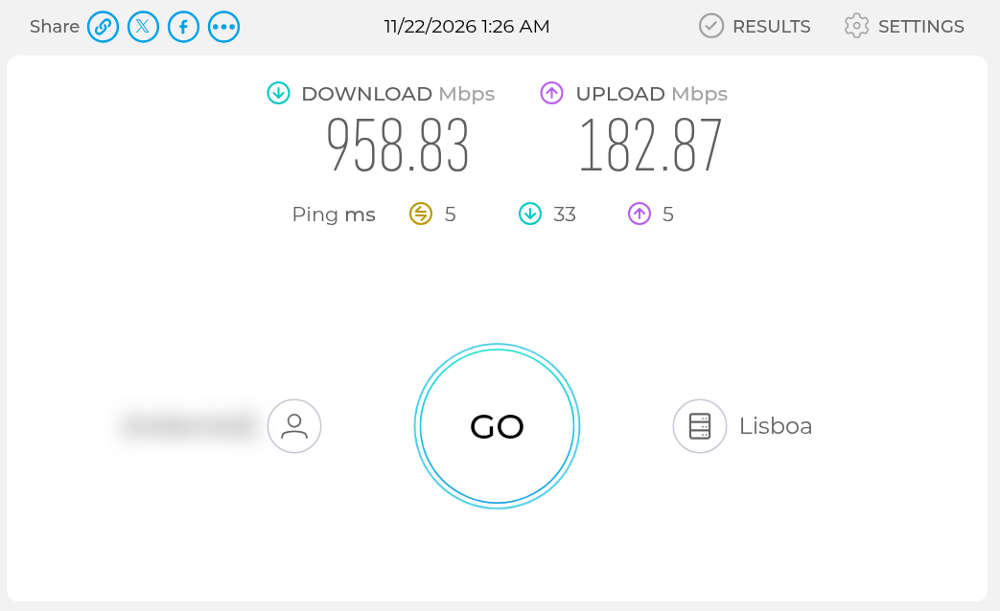
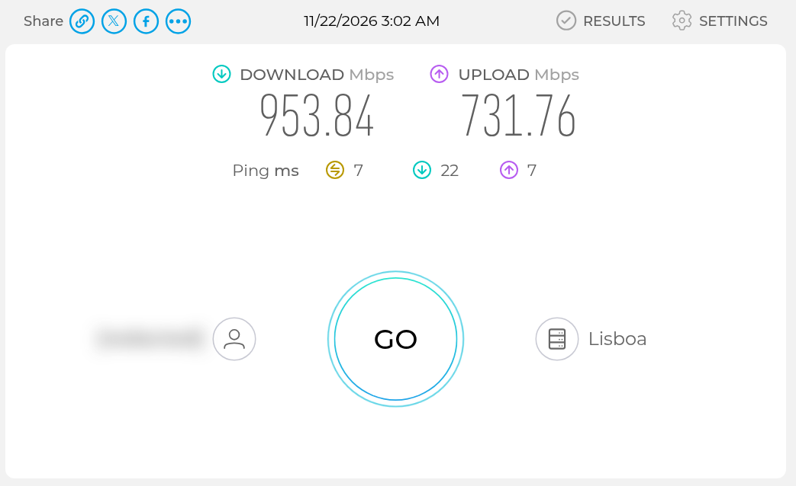
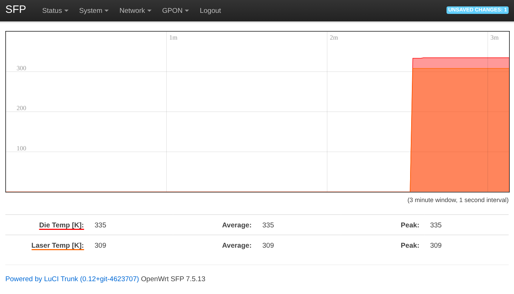

I hadn't run a proper speedtest in a long time. The internet worked, I
had other things to break, and I was taking the speed for granted.

Then, seemingly out of nowhere, I started getting low speeds. Downloads
weren't behaving the way I expected, and loading the connection could
make other things feel worse too. So I finally started investigating.

One of the first Waveform tests came back at about **364 Mbps down and
217 Mbps up**. On a connection that was supposed to be 1000/1000.

Excellent. I had replaced the ISP router with a server, a VM, and a rooted
GPON stick, and now I needed to find out which part of my very sensible
arrangement was eating the internet.

I don't have a clean timeline for when the slowdown started. Not measuring
it for ages makes that surprisingly difficult. What I could do was test
the current setup properly, change one thing at a time, and see which
changes actually survived being reversed.

## Previously, on Unnecessary Networking Projects

The setup is still the one from [replacing my ISP router](/posts/router/router)
and [getting 2.5 Gbps working on the Broadcom card](/posts/nicupgrade/nicupgrade):

```text
Fiber
  → Huawei MA5671A GPON stick
  → Broadcom BCM57810S in the HP DL560 G8 / Proxmox
  → OPNsense VM
  → Juniper EX3300
  → Wired PC
```

The stick-to-NIC link runs at **2.5 Gbps**. That is the local link speed,
not a promise of 2.5 Gbps from my ISP. The internet plan is still gigabit.

The results weren't even consistently bad in the same direction. Another
test, from the PC using its SFP+ connection, managed almost full download
speed while upload was still around **183 Mbps**.



Different tests were giving me different numbers, but there was clearly
something worth fixing. The IP addresses and identifying details in the
screenshots are obscured.

## The Stick Was Dropping More Than My Patience

The first useful lead was the stick's upstream buffers. There were queue
and port discard counters increasing under load, and the configured
limits were small.

Instead of changing them once and declaring victory because a speedtest
looked nicer, I compared the original settings, larger buffers, and then
the original settings again. Same test endpoint and method:

| Upstream buffer settings     |         Upload |
| ---------------------------- | -------------: |
| Original limits              | About 162 Mbps |
| Larger queue and port limits | About 755 Mbps |
| Original limits restored     | About 158 Mbps |

That was the most convincing result of the whole investigation. The
upload improved when the limits increased, and collapsed again when they
were restored. The original limits were contributing to the problem.

The settings I kept were **1024 minimum / 2048 maximum** for the green
and yellow drop thresholds on upstream queue 0, and **2048** for the
green and yellow limits on upstream port 0. Those are the driver's
threshold values, not Mbps or a claim that every buffer is 2048 bytes.
The other queue settings were preserved.

There was also a persistence problem: the stick gets provisioned by the
OLT through OMCI, so changing something once in a shell doesn't mean it
will stay that way after registration or a reboot.

I ended up with a small `gpon-buffer-tune` service on the stick. It checks
the queue and port settings every 30 seconds and reapplies the tested
values when necessary. It also checks that queue 0 is still mapped to
the expected upstream port before touching anything.

This is specific to my firmware and queue mapping. It isn't a universal
"paste this into every GPON stick" fix. But on this setup, it made a
very visible difference.

## The NIC Also Wanted Attention

The stick wasn't the only place dropping packets. The Broadcom card's
receive rings were set to **239 entries**, while the driver supported
**4078**. Under load, I was also seeing receive discards on the host.

The ring is where the NIC can queue received packets for the host to
process. I increased it and checked the counters again:

| Trial                      | WAN hardware receive discards during the test |
| -------------------------- | --------------------------------------------: |
| Original 239-entry ring    |                                           283 |
| 4078-entry ring            |                                             0 |
| Original ring restored     |                                            35 |
| 4078 entries on both ports |                                             0 |

The test durations and traffic weren't identical enough to compare those
counts as precise loss rates. What mattered was that the drops returned
with the original setting, and weren't observed in the larger-ring trials.

I kept **4078 RX entries on both `eno1` and `eno2`**, the LAN-facing and
stick-facing ports. The commands are:

```sh
ethtool -G eno1 rx 4078
ethtool -G eno2 rx 4078
```

To retain them, I added the corresponding `post-up` command under each
existing physical interface stanza in Proxmox's `/etc/network/interfaces`:

```text
iface eno1 inet manual
    post-up /sbin/ethtool -G eno1 rx 4078

iface eno2 inet manual
    post-up /sbin/ethtool -G eno2 rx 4078
    # Existing link-speed and flow-control settings stay here too.
```

That is an excerpt, not a replacement for the whole network config.
`ethtool -g` confirmed both ports retained the new RX values. I left
the TX rings alone.

This removed the hardware receive discards observed in those trials.
It did **not** suddenly turn the upload into a full gigabit. Apparently
the network had enough problems to give each fix its own job.

## Maybe the Rest of the House Was Eating It?

One possibility was that the PC's speedtest was only getting what was
left after everything else in the house had taken its share.

So I measured the OPNsense WAN counters while the PC ran a test. During
download, the WAN averaged about **984 Mbps**, while the PC reported
about **941 Mbps**. There was some other download traffic, and the
counter and application measurements don't count exactly the same things.

Upload was different. The WAN averaged about **668 Mbps**, with the PC
reporting **661 Mbps** and other household upload traffic around **5 Mbps**.
The missing upload wasn't quietly being used by something else.

I also tested from a container connected directly to the WAN bridge,
bypassing OPNsense, the switch, and the PC. The reduced upload was still
there. Even overlapping tests from that container only reached roughly
**813–826 Mbps combined** over their common upload intervals.

That narrowed the remaining investigation to the host, stick, and GPON
path. It didn't identify the exact remaining fault, but it gave me a
reason to stop blaming every OPNsense checkbox.

## Fine, Bring Back the ISP Router

I remembered the original router doing the full 1000/1000, so I connected
the same PC directly to it and repeated the measurements. For the matched
comparison, the PC used its 1 Gbps Ethernet connection on both paths,
the same IPv4 speedtest server, and latency probes during download.

| Connection                       | Download |   Upload | Idle ping | Download ping |
| -------------------------------- | -------: | -------: | --------: | ------------: |
| Original ISP router              | 976 Mbps | 817 Mbps |    6.5 ms |        7.6 ms |
| Stick, Proxmox, OPNsense, switch | 954 Mbps | 732 Mbps |    6.5 ms |       17.5 ms |

The original router was still better, especially for latency under load.
But it also wasn't doing 1000 Mbps upload in these tests: repeated runs
were around **814–817 Mbps**. My memory of the old result wasn't a
substitute for measuring it again.

There were also occasional HTTPS stalls even on the ISP router, despite
its fairly flat ICMP ping. A nice ping graph doesn't describe every
connection. On the stick path, one captured stall included a TCP
retransmission about **217 ms** after the original packet. That showed
loss recovery contributing to the delay, without proving where that
particular packet disappeared.

## The Settings That Didn't Earn a Permanent Home

I tried forcing the stick-to-NIC link back to 1 Gbps. It was worse.
Traffic shaping didn't restore the missing upload either, and a tested
OPNsense download FQ-CoDel configuration reduced throughput enough that
I removed it.

I also tried a larger shared buffer pool and BBR in the direct test
container. Neither demonstrated a complete fix, so those experiments
were reverted too.

The permanent changes from this investigation are the **stick's queue/port
buffer service** and the **larger RX rings on both Broadcom ports**.
There is no experimental shaping left enabled.



Much better than the original bad results. Still some way off the upload
I'd like, and still extra latency when downloading heavily.

## Maybe the Tiny Computer Needs Some Air

While writing this, I checked the stick's internal temperature readings:

```text
optic mmdtg
errorcode=0 temperature=335

optic mmltg
errorcode=0 temperature=309
```

The firmware reports those in **Kelvin**, as its own temperature page
also labels them. The die varied between 334 and 335 K while I checked,
putting the **die at about 61–62°C** and the
**laser sensor at about 36°C**.



These were readings taken while writing, not a temperature log from the
earlier speedtests. I haven't demonstrated thermal throttling, and a
62°C die reading alone doesn't prove overheating or explain the upload
limit. There hasn't been a controlled fan-on/fan-off comparison yet.

But I do want to give the stick some better airflow and repeat the same
tests once it's cooler. A small heatsink or fan is a much more appealing
next experiment than another evening of staring at queue counters.

For now, it still isn't perfect: **roughly 900/700** is the honest short
version, with some tests closer to 950/730. I believe cooling the GPON
stick is worth trying next, so I want to get that sorted ASAP and check
the speeds and loaded latency again.
