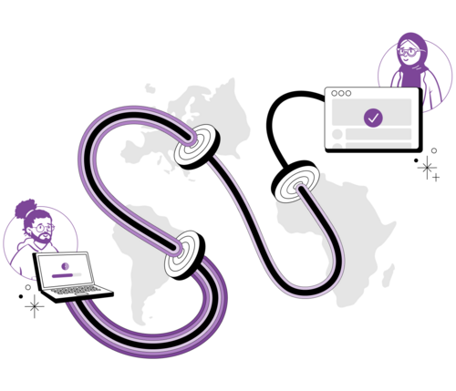
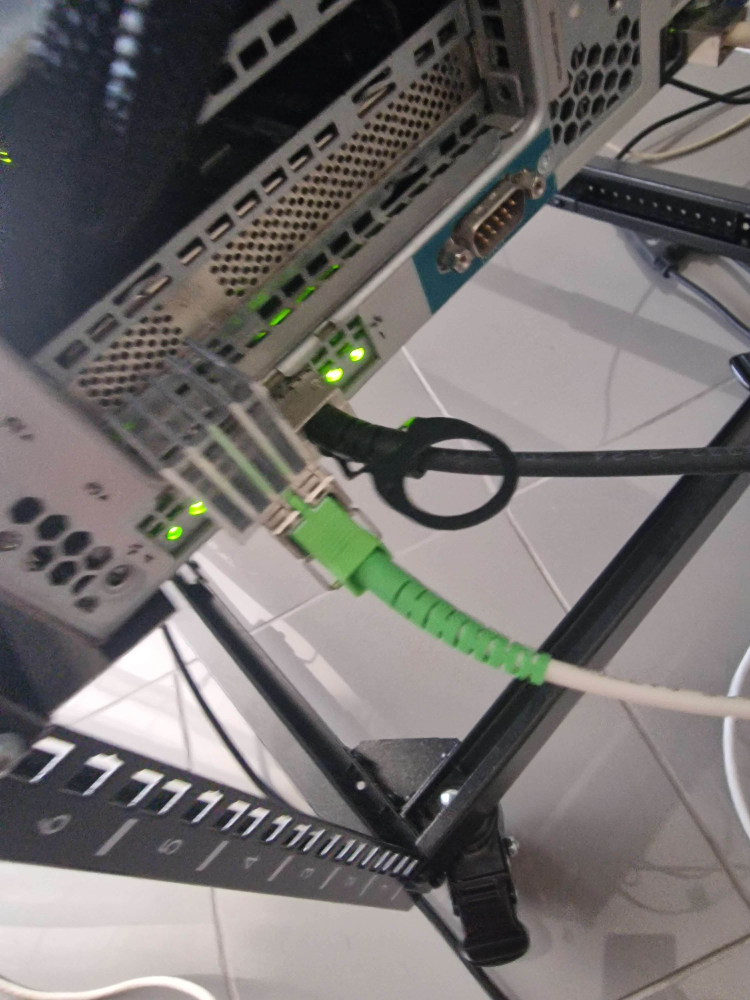
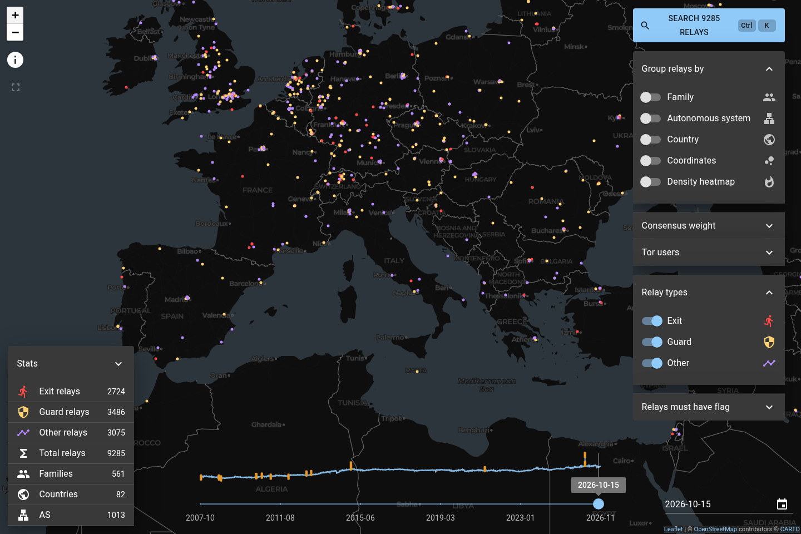
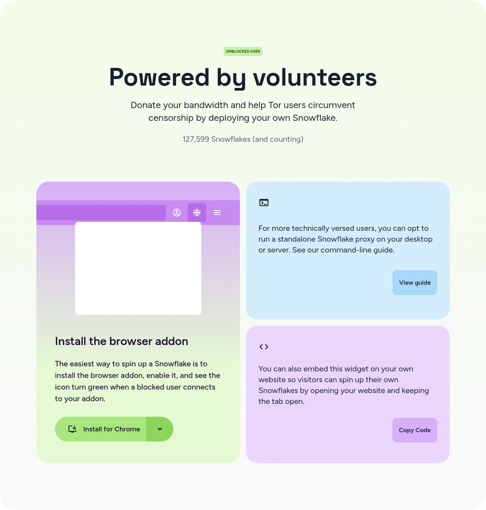

After [replacing my ISP router](/posts/router/router) and
[chasing the missing gigabit](/posts/gigabit/gigabit), I finally found
something to do with the bandwidth that doesn't involve running another
speedtest.

I'm now hosting a **Tor relay, an obfs4 bridge, and a Snowflake proxy**
on the home server.

The server is already on anyway. Giving some bandwidth to people who
need it seemed like a decent use for it, especially compared to most
of the things I've put this machine through.

## What Did I Actually Install?

Tor sends connections through several relays before reaching the
website you're visiting. Those relays are run by volunteers, so I
wanted to contribute one of my own.

Diagram: [Tor Project](https://support.torproject.org/tor-browser/getting-started/about-tor-browser/).

The three things I'm running have slightly different jobs:

- **The public relay** passes traffic through the Tor network. It can
  also become a guard, the first hop, when Tor considers it suitable.
- **The obfs4 bridge** helps people connect where Tor is blocked. It
  stays out of the public relay directory and disguises the connection.
- **The Snowflake proxy** gives censored users another way in, forwarding
  their connections to Snowflake's bridges.

The public relay is called **oPeras**. You can follow it on Tor Metrics
by clicking its fingerprint:
[679159D1D9057AF8C4E3D223940FC4B9A96EB0D9](https://metrics.torproject.org/rs.html#details/679159D1D9057AF8C4E3D223940FC4B9A96EB0D9).

## No Exit, Thanks

I deliberately didn't set up an **exit relay**, which is the part that
connects Tor users to websites outside the network.

With an exit, those websites would see my public IP. Abuse complaints
could then end up with my ISP, and I don't want them closing my
connection over someone else's traffic.

I've spent enough time fixing this internet already.

There are [several ways to contribute to Tor](https://community.torproject.org/relay/types-of-relays/),
so helping out didn't have to mean volunteering my home connection
for that particular headache.

## Two More Containers Won't Hurt

Everything runs in two small **Debian 13 containers on Proxmox**. One
holds the public relay and Snowflake, and the other holds the bridge.
No new hardware, thankfully.

Still the same server. The fiber setup has acquired another job.

I reused the network arrangement from an existing test container:
**vmbr2, VLAN 100, and DHCP**. My ISP gave each new container its own
public IPv4 address.

That was useful for the bridge. The public relay's address is listed
for everyone to see, so putting the bridge on the same IP would make
it an easy target for the same blocklists.

You can explore the public network on [TorMap](https://tormap.org/).
Map tiles by CARTO and OpenStreetMap contributors. Bridges aren't shown.

I was more worried about disk space than CPU or RAM. After setup, the
two containers used about **780 MiB combined**, with disk limits of
4 GiB and 2 GiB. That was much more reasonable than finding another
excuse to [buy more disks](/posts/disks/disks).

SSH is disabled on both, and their firewalls only allow the traffic
they need. I can manage them through Proxmox.

## Bits and Bytes, My Old Friends

I initially allowed **200 MiB/s** while thinking of **200 Mbps**.

Those are, unfortunately, very different numbers. 200 MiB/s is about
**1.68 Gbps**, which was a slightly enthusiastic donation from my
home connection.

The relay and bridge are now capped at **20 MiB/s each**, about
**168 Mbps**. Plenty to contribute while leaving room for the rest
of the house. Snowflake runs separately and isn't covered by those
Tor bandwidth limits.

If you're setting one up yourself, I followed Tor's
[relay guide](https://community.torproject.org/relay/setup/guard/debian-ubuntu/)
and [obfs4 bridge guide](https://community.torproject.org/relay/setup/bridge/debian-ubuntu/).

## Also, Snowflake

[Snowflake](https://snowflake.torproject.org/) was an easy addition.
It uses WebRTC, the same technology used for browser voice and video
calls, to help people reach Tor through volunteer proxies.

Screenshot: [Tor Project's Snowflake website](https://snowflake.torproject.org/).

Mine runs on the server, but you don't need a homelab to help. There's
a browser extension too. Leaving a small proxy running is a fairly
low-effort way to contribute if you have bandwidth to spare.

The containers survived a reboot, the relay was reachable from outside,
and I could browse through the new obfs4 bridge. Everything was working
by the end of it.

Now I'll leave them running and see how much use they get. The server
finally has a job that doesn't involve me complaining about my ISP.
