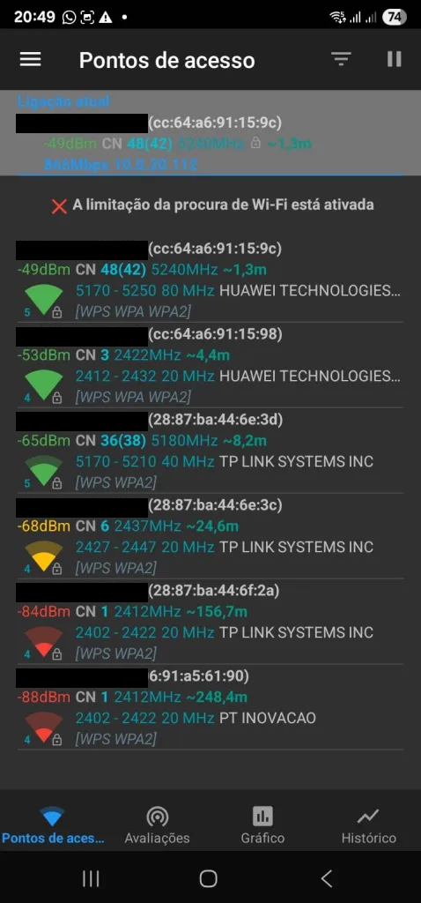
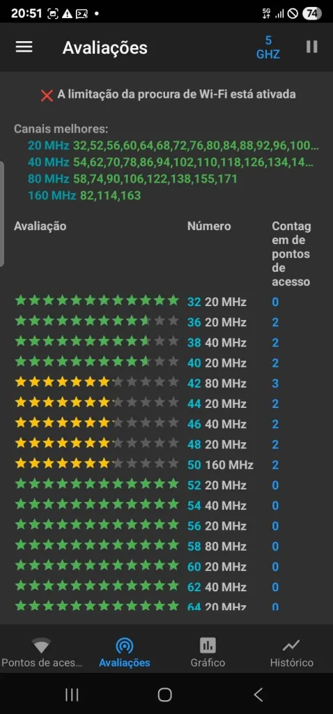
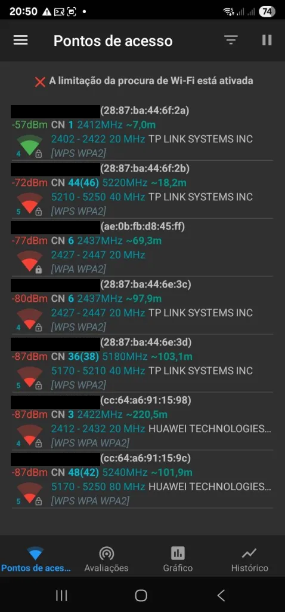
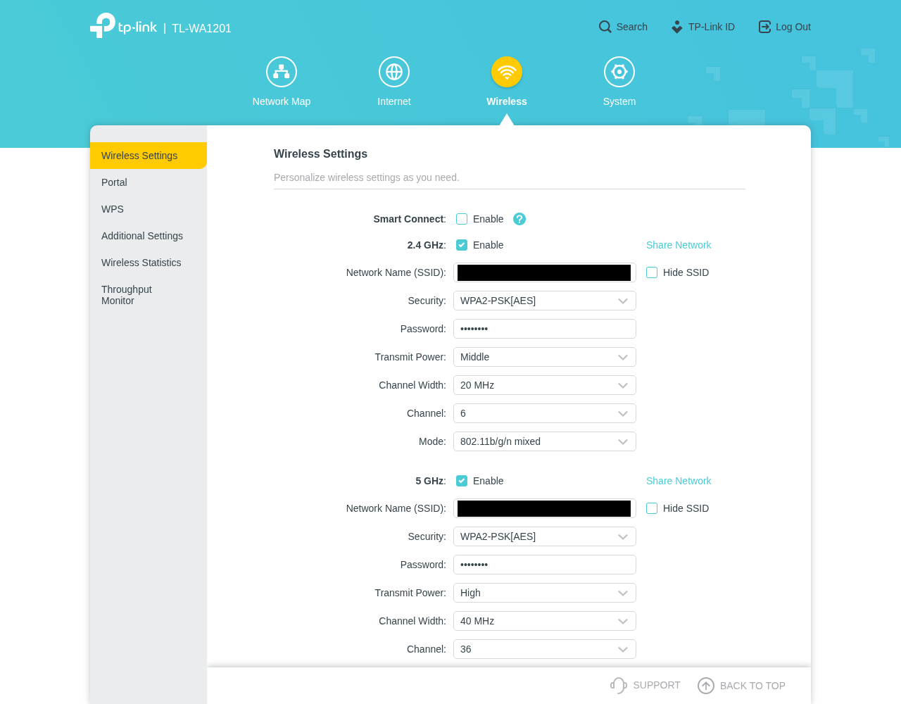

My house has [its own ASN and IPv6 block](/posts/bgp/bgp). I have a
rooted GPON stick, OPNsense handling the network, and a BGP session to a
VPS so I can use my own addresses at home.

My phone would still occasionally stop loading things when I walked
between floors.

Apparently, BGP does not help your Wi-Fi get through concrete. (<- this is a joke)

## The Hardware I Didn't Want to Replace

The house has three floors, with one access point on each:

| Floor        | Access point                       |
| ------------ | ---------------------------------- |
| First floor  | Huawei HS8247W, the old ISP router |
| Ground floor | TP-Link TL-WA1201                  |
| Basement     | Another TP-Link TL-WA1201          |

All three are connected by **Ethernet**. OPNsense does the routing,
firewalling, and DHCP. These boxes just provide Wi-Fi.

And yes, that is the ISP router in the table. I went through all the
trouble of [replacing it with OPNsense](/posts/router/router), then
remembered I still needed Wi-Fi on the top floor. So I'm using it anyway.

It is no longer my router, at least. The DHCP server is disabled, and
it is connected to the LAN to work as an access point. It already had
wireless radios and Ethernet ports, and reusing it cost nothing. That
was enough to earn it another job.

The **TL-WA1201s** are cheap standalone Wi-Fi 5 APs. My APs kind of suck,
but I also don't want to spend much money replacing them. Before buying
a nicer wireless setup, I wanted to see what I could get out of the
hardware already sitting in the house.

## What Was Actually Happening

Wired connections were fine. Over Wi-Fi, I would get lag or brief
periods where the phone looked connected but things stopped loading.
My first suspicion was interference, or the APs getting in each other's
way. There was also the question of whether the phone was actually
switching APs as I moved around.

I installed [WiFi Analyzer on Android](https://play.google.com/store/apps/details?id=com.vrem.wifianalyzer)
and walked around the house. The useful view was the access point list:
each radio's **BSSID**, signal strength in dBm, channel, and channel width.
The shared network name alone doesn't tell you which box you're using.

This was before changing the Huawei. The TP-Links had already had their
first channel adjustments. I've blacked out the network names in the
screenshots; the BSSIDs still distinguish the individual radios.

The scans weren't perfect. Android's Wi-Fi scan throttling was enabled,
so the app couldn't update continuously as I moved. That makes a quick
walk around less precise, but the readings were enough to see the
channel layout. I also took a reading outside, which I left out of the
coverage assessment. Getting reliable Wi-Fi inside the house was the goal.

## The Channels Were a Mess

The ground-floor TP-Link was initially on **channel 8** in 2.4 GHz,
with automatic channel selection and width. The Huawei was using
**channel 3**. Once the two TP-Links had been moved to channels 1 and 6,
the Huawei was still sitting between them, overlapping both.

On 5 GHz, the Huawei was using an **80 MHz** channel spanning the
same spectrum as both TP-Links' 40 MHz channels.

That was the bit worth checking properly: different primary channel
numbers don't necessarily mean separate spectrum. An 80 MHz network
with primary channel 48 can overlap a 40 MHz network with primary
channel 36. Looking only at the channel number misses half the picture.

The ratings view makes the occupied range easier to spot, though the
stars alone don't measure how busy those networks actually are.

The Huawei also had different security settings. It used mixed
**WPA/WPA2 with TKIP/AES**, while the TP-Links used **WPA2/AES**.
The SSID and password matched, but the authentication settings didn't.

None of that proved the exact cause of every interruption. It did give
me several concrete things to sort out before blaming the hardware.

## Giving Each Floor a Channel

The final channel configuration looks like this:

| Floor                 | 2.4 GHz            | 5 GHz              |
| --------------------- | ------------------ | ------------------ |
| First floor, Huawei   | Channel 11, 20 MHz | Channel 44, 40 MHz |
| Ground floor, TP-Link | Channel 6, 20 MHz  | Channel 36, 40 MHz |
| Basement, TP-Link     | Channel 1, 20 MHz  | Channel 44, 40 MHz |

On 2.4 GHz, that gives each floor its own non-overlapping channel.
I fixed the width at **20 MHz** on all three.

On 5 GHz, the ground floor gets one 40 MHz block, and the first floor
and basement share the other. Those two APs are separated by two floors,
and the scans showed that they reached each other's areas relatively
weakly. Reusing a channel there seemed a reasonable compromise.

Near the basement AP, its 2.4 GHz radio was at about **-57 dBm**, while
the Huawei radios were around **-87 dBm**. This scan was also taken
before finishing the Huawei's configuration.

I could have used DFS channels to separate them further. For this first
configuration, I stayed with fixed non-DFS channels, avoiding potential
radar-triggered channel changes. There is less peak bandwidth than with
80 MHz, but a bigger link-speed number wasn't what I was trying to fix.

The basement AP after the changes. The Huawei uses the same 5 GHz block
two floors above it, with the ground-floor AP on the other block.

I also reduced 2.4 GHz transmit power: **Middle** on the TP-Links and
**60%** on the Huawei, while leaving 5 GHz power high. Those aren't
equivalent power scales across manufacturers. They are starting points
for reducing overlap, and still need checking against indoor coverage.

Smart Connect on the TP-Links and band steering on the Huawei are now
disabled. The bands still share the same SSID and password, so the phone
can choose between them. Disabling Smart Connect also lets me set the
TP-Links' transmit power separately for each band.

All three APs now use **WPA2/AES**. Both TP-Links are on firmware
**1.15.0**, and I confirmed that DHCP is disabled on all three boxes.
OPNsense keeps that job.

## Where It's At Now

The settings were read back after saving, and the basement TP-Link
retained them after its firmware update. Short wired ping tests to all
three APs completed without packet loss. That checks basic reachability,
but it doesn't measure wireless performance or roaming.

The phone still decides when to leave one AP and join another. Giving
the APs matching network settings and a sensible channel layout doesn't
turn three independent boxes into a centrally managed wireless system.
It also doesn't prove that every interruption came from interference.

I've tested it a little around the house, and it seems to be working
better. Nothing scientific, and I haven't measured the roaming times,
but the initial impression is better than before.

I'll keep using it over the next few months and see how it holds up.
Realistically, I'll probably forget about the whole thing until the
Wi-Fi annoys me enough to investigate it again.

For now, the radios have a consistent configuration and I have a reason
for each channel choice. If it still struggles, placement and coverage
are the next things to investigate before buying anything.

The old ISP router gets to stay employed a little longer.
